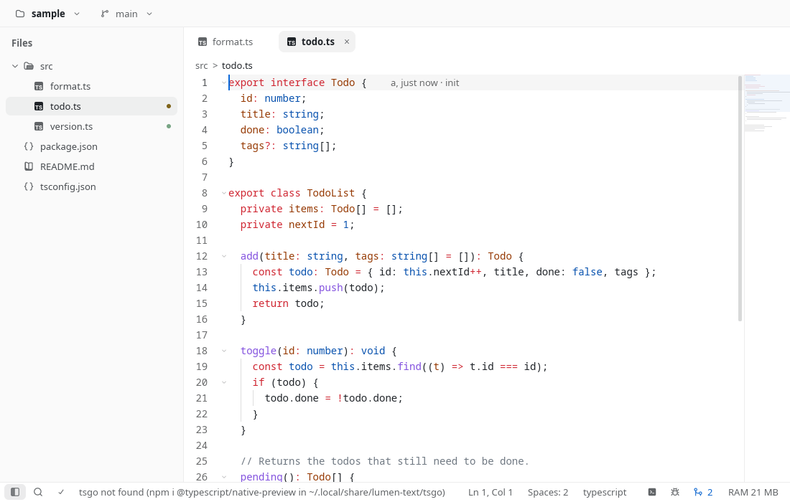
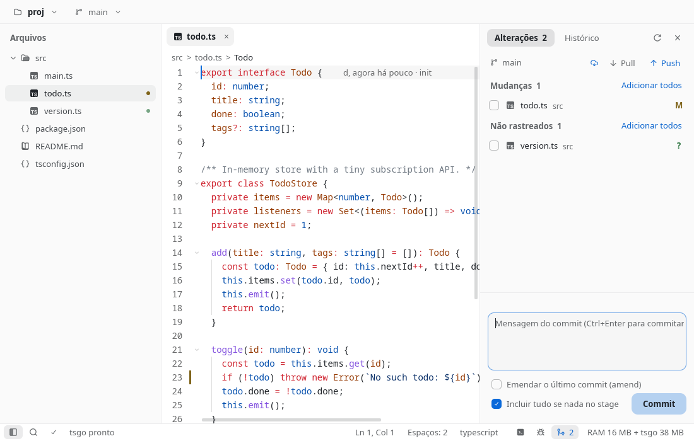
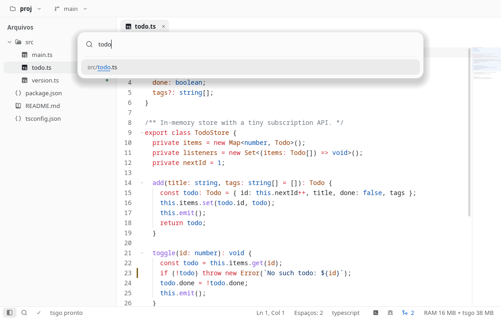
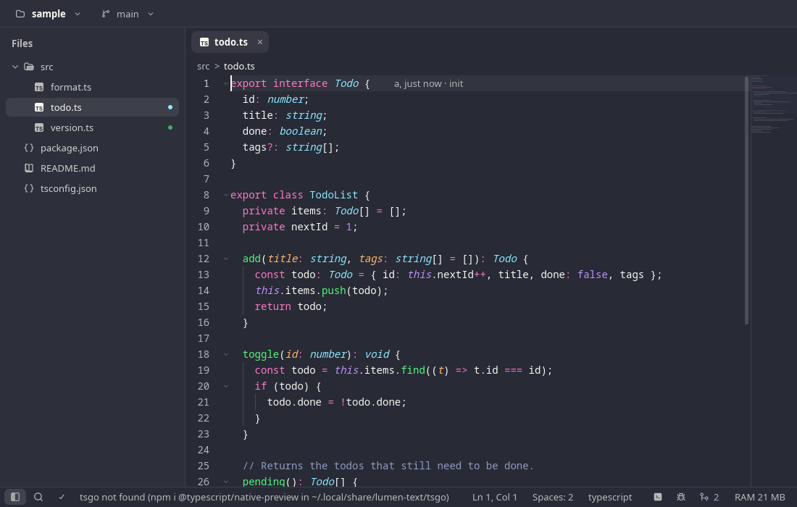
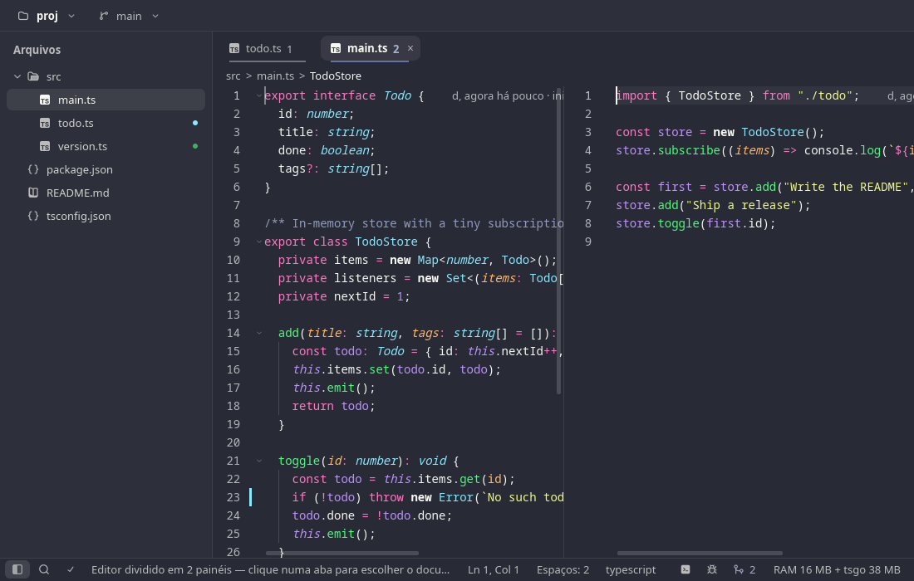
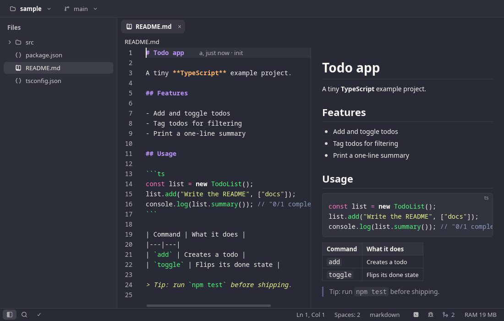

<p align="center">
  
</p>

# lumen-text

**A lean, CPU-rendered code editor for Linux, Windows and macOS, written 100% in Rust, with a first-class TypeScript workflow.**

[](https://github.com/castrogusttavo/lumen-text/actions/workflows/ci.yml)
[](LICENSE)
[](https://github.com/castrogusttavo/lumen-text/releases)



**[Changelog](https://castrogusttavo.github.io/lumen-text/changelog)** · **[Roadmap](https://castrogusttavo.github.io/lumen-text/roadmap)** · **[Docs](https://castrogusttavo.github.io/lumen-text/docs/getting-started)** · **[Releases](https://github.com/castrogusttavo/lumen-text/releases)**

## Why

Modern editors are great and heavy. lumen-text is an experiment in how far you can get with a small
memory budget (the editor itself stays around **20 MB**; the TypeScript server adds **~65 MB for a small project and several hundred MB for a very large one**, see the table below)
and no GPU driver:

- Everything is drawn on the CPU (`softbuffer` + `tiny-skia`), so it runs anywhere a Wayland or X11 window does.
- Highlighting uses the same TextMate grammars and VS Code themes as [Shiki](https://shiki.style)
  (65 themes, 260 grammar files), through a port of the `vscode-textmate` core on top of `onig`.
- TypeScript is served by [`tsgo`](https://github.com/microsoft/typescript-go) (the native TypeScript
  compiler) started on demand with full project awareness (like VS Code or Zed); an opt-in *lean mode* only loads open files and their imports for low-RAM machines.
- Any language server works: a built-in table (rust-analyzer, pyright, gopls, clangd, jdtls (Java), csharp-ls (C#),
  kotlin-lsp, lua-language-server, taplo, the vscode JSON/CSS/HTML servers, yaml, bash, marksman, zls, ruby-lsp,
  phpactor, Dockerfile, sourcekit-lsp, dart, elixir-ls, haskell, metals, svelte, astro, vue, Tailwind, deno...)
  starts a server **only when a matching file is opened and the program is installed**; add your own in `config.json`.
- One process per window (several windows are fine), one font in memory, no web view, no Electron.

## What's new

Release **2026.11.12.1** is the biggest so far: local history, hot exit and crash recovery, persistent undo and file
encodings (nothing is lost, any file opens); several AI agent sessions, worktrees, several terminals and the kitty
keyboard protocol; replace in project, macros, column selection and jump to character; stashes, a commit graph, line
staging and a 3-way merge editor; per-project settings, zen mode and an image viewer; project-wide problems, inline
completions and test coverage; right-to-left text and multiple windows. The full list, with enhancements and bug fixes,
is in the [changelog](https://castrogusttavo.github.io/lumen-text/changelog); what comes next is on the
[roadmap](https://castrogusttavo.github.io/lumen-text/roadmap).

## Features

**Editor**
- Rope buffer (`ropey`), atomic save, CRLF, tree-shaped undo history, opens a 100k-line file in ~21 ms
- File encodings: UTF-8 (with or without BOM), UTF-16 LE/BE (BOM or no BOM) and Windows-1252 are detected and saved back the same way; the bottom bar shows the encoding and offers "Reopen with encoding…" / "Save with encoding…" (also ISO-8859-1/15/2, Windows-1250/1251/1253/1254, KOI8-R, Shift_JIS, EUC-JP, GBK, Big5, EUC-KR). Binary files are refused with a message instead of opening as garbage
- [EditorConfig](https://editorconfig.org): `indent_style`, `indent_size`, `tab_width`, `end_of_line` (files without a line break yet), `charset`, `trim_trailing_whitespace`, `insert_final_newline` and `max_line_length` (read, not used yet), with the usual section globs, applied when a file opens
- Render whitespace (none / boundary / trailing / all, palette "Toggle render whitespace"); trim trailing whitespace and insert a final newline on save (one undo step; Markdown is not trimmed unless `.editorconfig` asks)
- Multi-cursor, auto-indent, bracket pairs and matching, JSX/HTML tag closing, Emmet, snippets with tab stops
- Column (box) selection: `Shift+Alt+drag`, middle-button drag or `Ctrl+Shift+Alt+arrows`; one cursor per line in visual columns (tabs expanded), carets at the end of shorter lines, folded lines skipped, buffer lines (not wrapped rows) with word wrap
- Jump to character (`Alt+J`, flash / easymotion style): type 1–2 characters, then the label shown over the match (`Shift` extends the selection)
- Word wrap, folding, sticky scroll, indent guides, minimap, breadcrumbs, color swatches
- Rulers at the columns you choose (`rulers`); inline diagnostics after the code, Error Lens style (`inline_diagnostics`: off / current line / all, palette *View: Inline diagnostics*)
- Find/replace (case, regex), project search, symbols, go to line, back/forward navigation
- Replace in project (`Ctrl+Shift+H`): case / whole word / regex with `$1` captures, a preview of every replacement, replace one match, a file or everything (after a "Replace 42 matches in 7 files?" question); open files are edited in their buffer (one undo step, left unsaved), the others rewritten atomically with their line endings; `.gitignore` respected like the search
- Keyboard macros: record with `Ctrl+Shift+R` (keys and commands, not the mouse; a REC pill in the bottom bar), replay with `Ctrl+Alt+R` or N times from the palette, as one undo step; save them by name in `macros.json` and bind them in `keybindings.json`
- Tabs, quick open (fuzzy), session restore, live reload when files change on disk (inotify)
- **Local history**, independent of git: a snapshot on every save and right before a buffer is reloaded because another program (a formatter, `git checkout`, the AI agent) rewrote the file. *File: Local history* (also in the tab and explorer context menus) lists them ("3 minutes ago · Saved", date, size), opens a side-by-side diff of the snapshot against the buffer and restores it as one undoable edit (`r` or *Restore this version*); *File: Local history (deleted files)* brings back files that no longer exist. Stored in `$XDG_STATE_HOME/lumen-text/history` (default `~/.local/state`): identical snapshots are skipped, files over 5 MB are not kept, 50 snapshots per file and 200 MB in total (oldest pruned first)
- Never lose anything: **hot exit** (quitting keeps unsaved tabs, untitled ones too, and reopens them next time, no save prompt), **crash recovery** (unsaved buffers are backed up a few seconds after each edit; a backup whose file changed on disk meanwhile is still restored, with a notice) and **persistent undo** (a file's undo tree survives closing it and restarting while its text is unchanged)
- Always up to date: a `git checkout` / `commit` / `pull` typed in a terminal refreshes the branch, gutter marks and status (the repository's `.git` is watched); on NFS, SMB, FUSE/sshfs, 9p (WSL), FAT/exFAT or when the inotify watch limit is reached, the open files and expanded folders are polled instead (status bar: *Polling (NFS)*); regaining the window focus re-checks what changed; *File: Refresh explorer and git status* (palette, or the button in the explorer header) re-reads everything
- Reopen closed tabs (`Ctrl+Shift+T`, palette *View: Reopen closed tab*, tab menu): the last 20, each back in its split pane with its cursor, selection and scroll
- Save as administrator: when a save is refused for lack of permission (`/etc/hosts`) a card offers to write the file in place through `pkexec` (Linux) or the macOS password prompt, keeping its owner and mode
- Multiple windows (`Ctrl+Shift+N`, *File: Open folder in new window…*, drag a tab out of the window or *Move to New Window* on a tab, unsaved text included); `lumen-text` without arguments reopens every window of the last run with its own tabs and size
- Fonts: separate **interface** and **buffer** (code, terminal, diffs) fonts with a searchable picker of the installed families, weight, size, line height and ligatures, all live
- Buffer font OpenType features (`zero`, `ss01`, `cv02`...) and letter spacing, previewed in the font picker; columns and the caret stay aligned
- Zen mode (`Ctrl+K Z`): bars, sidebar, panels and minimap hidden, the text centered in a column of `zen_max_width` columns; `Esc Esc` brings the layout back exactly. The tab bar and the status bar can also be switched off on their own
- Explorer order: by name (numbers by value, `file2` before `file10`), type, date modified or mixed, folders first or not (right-click the explorer's header)
- Display options: line numbers, bookmarks (`Ctrl+F2`), breakpoint dots, scrollbars (show / auto-hide / never) and a master switch for the language servers
- Smooth Zed-style scrolling, drag selection by word/line, Wayland and X11 clipboard, IME, fractional hi-DPI scaling

**TypeScript and LSP**
- Diagnostics, rich Markdown hover, completion, signature help, definition, references, rename,
  organize imports, quick fixes (`Ctrl+.`), expand selection, call hierarchy
- Semantic tokens, optional code lens and inlay hints, optional auto-import
- Document highlights: the caret resting on a symbol lights its read/write occurrences (`textDocument/documentHighlight`; the same word when no server offers it)
- Linked editing: renaming an opening tag renames the closing one live, one undo step (`textDocument/linkedEditingRange`: tsgo for JSX/TSX, the HTML server for HTML)
- **Inline completions** (opt-in, setting `inline_completion`): faded ghost text from any language server with `textDocument/inlineCompletion`, such as GitHub Copilot's `copilot-language-server` with your own login (*Copilot: Sign in*, device code; Lumen never handles API keys). `Tab` accepts, `Ctrl+Right` takes a word, `Esc` dismisses, `Alt+]` / `Alt+[` cycle, `Alt+\` asks; a status bar item shows on / off / signed out / loading
- Full-project mode (default; also reacts to files changed, created or deleted on disk) versus an opt-in lean mode; uses the project's own `tsgo` or a bundled one
- Formatting with the project's Biome or Prettier (falls back to `tsgo`), or the formatter you pick per language
  (`formatter`); code actions on save (`code_actions_on_save`, e.g. organize imports and fix all, ~1 s timeout each,
  never blocking the save); lint through `biome lsp-proxy` and ESLint
- Problems panel (*View: Problems*): problems grouped by file with counts, most severe first, scope switch
  *Open files* | *Whole project* (`Alt+W`); the whole project adds what servers report for files that are not open and
  uses LSP 3.17 workspace pull diagnostics (partial results, result ids, cancelled when you leave), bounded in memory
- **Language servers beyond TypeScript** (see the [Language servers](web/src/content/docs/language-servers.md) page): a data-driven
  registry (`src/lsp_servers.json`) plus `language_servers` in `config.json`; one process per (server, workspace root), started lazily,
  stopped after an idle grace period, restarted with backoff when it crashes; several servers per file (a primary plus companions such
  as Tailwind or ruff) with merged diagnostics, hover, completion and code actions; status, switches and a bounded server log
  (palette: *LSP: Restart language servers*, *LSP: Show server log*)
- Python: the project's virtualenv (`.venv`, `venv`, `$VIRTUAL_ENV`, uv, Poetry's cache, any folder with a `pyvenv.cfg`) is
  handed to pyright/basedpyright (`python.pythonPath`, `venvPath` + `venv`) and activated for ruff (a ruff or basedpyright
  installed in the venv is preferred); *Python: Select interpreter…* pins another one per project; the language item's tooltip
  shows the active interpreter
- Spell checking (opt-in, `spell_check`): [harper-ls](https://github.com/Automattic/harper) (spelling and grammar in comments, strings, Markdown, plain text and commit messages) and [typos-lsp](https://github.com/tekumara/typos-lsp) run as companions when installed; their slips get a dotted info underline (never an error) and `Ctrl+.` offers the fixes and *add to dictionary*
- Vitest/Jest runs with pass/fail marks in the gutter, `package.json` and `cargo` tasks with an ANSI output panel
- Test coverage in the gutter (Vitest, Jest, `cargo llvm-cov`, or any `lcov.info` / Cobertura XML): covered / partial / uncovered bars, per-file percentage in the explorer and status bar

**Git**
- Gutter marks, branch switcher, status dots in the explorer, inline blame
- Git panel (`Ctrl+Shift+G`): stage/unstage files and single hunks, commit, amend, fetch/pull (merge, rebase or ff-only)/push (force with lease behind a confirmation), history
- Side-by-side diff with intraline highlight, file history, merge-conflict resolution (accept current / incoming / both)
- Worktrees (`Git: Worktrees…`, or the branch menu): list with branch, folder and dirty state; create one on a new or
  existing branch (default `<repo>/../<repo>-worktrees/<branch>`, see `git_worktree_dir`) in the background; open it in
  this window (each project keeps its own session) or in a new window; remove (asks, and asks again before forcing a
  dirty one) and prune. The branch chip shows a worktree icon when the project is a linked worktree
- Stashes in the panel: stash everything or the selected files (Ctrl / Shift + click; untracked files on request), apply, pop, drop, view a stash's files and diff; a stash that conflicts opens the conflicting file. Palette: `Git: Stash…`, `Git: Stash Pop`, `Git: Stashes…`
- Commit graph in the History tab: coloured lanes of every branch with merge and fork curves, branch / tag / HEAD labels, streamed a page at a time (smooth on 100k-commit repositories); right click a commit to check it out, branch or tag from it, cherry-pick, revert or copy its hash
- Stage, unstage or revert single lines: select rows in the diff (drag, or `Shift+↓`/`Shift+↑`) and press `s` (or the "Stage lines" button) / `r`; CRLF files and missing final newlines are kept exact
- Ignore whitespace in diffs (`-w`): header toggle, `w` key or `diff_ignore_whitespace`; staging a hunk or lines still stages their real text
- Compare with any branch, tag or commit (or a typed ref like `HEAD~3`): "Git: Compare with branch or commit…", "Compare two refs…", "Compare file with…"; the list of changed files opens each one side by side (`]` / `[` next / previous file, `f` the list), and its first entry switches to "since the branches diverged" (merge base, like a pull request; `main...` typed does the same)
- 3-way merge editor for merge, rebase and cherry-pick conflicts: Incoming | Current panes over the editable result, per-conflict checkboxes, conflict navigation and "Mark resolved" (stages the file)
- Right-to-left text: lines with Arabic, Hebrew or Persian are shown in visual order (Unicode bidirectional algorithm, joined Arabic shaping), with caret, click and selection mapped to the logical text; the Markdown preview and hover cards reorder and right-align RTL paragraphs. Lines without RTL letters never leave the fast path

**Debugging**
- Breakpoints in the gutter, step over/into/out, stack, variables and output tab
- TypeScript/JavaScript through js-debug; Rust and C through `gdb` DAP

**Terminal**
- Integrated PTY terminal with an xterm-compatible emulator (`vte`): truecolor, bold / dim / italic / underline / strikethrough, wide characters, 5,000-line scrollback, alternate screen (`vim`, `less`), bracketed paste, mouse and focus reporting, synchronized output, OSC titles, hyperlinks (`Ctrl+click`), clipboard and notifications
- Mouse selection with `Ctrl+Shift+C` / `Ctrl+Shift+V`; modified keys the xterm way (`Shift+Enter`, `Shift+Tab`, `Ctrl+Left`...)
- Several terminals, each with its own shell, scrollback and state: a tab strip in the panel header (`+` new, `×` kill, double click renames; titles follow the program's OSC title or the foreground process), ``Ctrl+Shift+` `` for a new one, and a split that shows two side by side (the clicked one gets the keyboard)
- Kitty keyboard protocol (progressive enhancement flags 1, 4, 8 and 16, per-screen flag stack) for modern TUIs such as Claude Code, Codex, Neovim and Helix: `Esc`, `Ctrl+…` and modified `Enter` / `Tab` / `Backspace` arrive unambiguously; programs that don't ask keep the legacy encoding. The AI panel's agent gets it too
- Killing a terminal (its tab's `×` or *Terminal: Kill*) while its shell runs a job (`npm run dev`) asks first, naming it; quitting asks when any terminal has a job, a task runs or a Build & Run process is alive. An idle shell closes without a question (Unix)

**AI panel**
- Your own agent CLI (Claude Code, Gemini CLI or Codex CLI) in a panel on the right (`Ctrl+Shift+A`), sharing the slot with the Git panel (a `Git | AI` switch on top). It runs in the project folder with your environment and its own login: Lumen never handles API keys
- Several agents at once: one tab per session (agent icon, name, status dot), `+` starts another (pick the agent), double-click renames, middle-click or `×` closes. Each session has its own terminal, status and working folder (`AI: New session in worktree…` starts one in a git worktree)
- Status chip (Starting / Working / Waiting for you / Done / Exited), Restart / Stop, a status bar badge summing up the sessions that finished or need you ("2 waiting"), and `Ctrl+Alt+A` to jump to the next session waiting for you
- Desktop notification when a session waits for you or is done while Lumen is in the background (`notify-send` or D-Bus on Linux, `osascript` on macOS; once per turn; `ai_notifications`)
- `Ctrl+V` pastes the clipboard as one bracketed paste, however long; an image is left to the agent (Claude Code reads it itself), files copied in a file manager paste as their paths
- While the panel has the focus every key goes to the agent (`Esc` included, `Ctrl+J`, `Ctrl+B`...); `Ctrl+Shift+P`, `Ctrl+Q` and `Ctrl+Shift+A` stay with Lumen. Click the editor or press `Ctrl+1` to type in the editor again

**Themes**
- 65 bundled VS Code themes with live preview (arrows apply, `Esc` restores), follow-the-system light/dark mode
- Import installed Zed themes, write your own custom theme (a template is generated for you)
- Text/background pairs checked against WCAG AA in every theme

**Markdown preview**
- Side-by-side reader (`Ctrl+Shift+V`) with live updates, scroll sync in both directions, highlighted code blocks, clickable links

**Images**
- PNG, JPEG, GIF, WebP (animated GIF / WebP play when small enough, otherwise the first frame) and SVG open as a picture in their tab, with the decoders of the Markdown preview (no webview): checkerboard behind transparency, fit to the pane by default, `Ctrl+wheel` (around the pointer) / `Ctrl+=` / `Ctrl+-` / `Ctrl+0` (fit, then 100%) to zoom, drag / wheel / arrows to pan; the status bar shows size, file size and zoom
- SVG: a *Preview | Source* switch (top right, or `Ctrl+Shift+V`); the source is the normal editor and the preview follows unsaved edits
- Big pictures are decoded once and kept downscaled (at most 8 megapixels); the pixels go with the tab. Works in split panes and comes back with the session

**Split panes**
- Up to six panes (a row of four, or a grid up to 3x2), moveable tabs, per-pane focus shortcuts, saved with the session; the Markdown reader and the diff open inside the focused pane

**Customization**
- Settings modal (`Ctrl+,`) and shortcut editor with conflict detection
- `config.json`, `keybindings.json` (keys and mouse: side buttons, middle click, `Ctrl`/`Alt` + click or wheel), user themes folder, removable and reorderable bottom-bar items
- Per-project settings in `.lumen/config.json` (and a personal `.lumen/config.local.json`), per-language overrides
  (`"languages": {"python": {"tab_width": 4}}`), live reload, a *User | Project* switch in the settings modal

## Screenshots

| | |
|---|---|
|  |  |
| Git panel (light) | Quick open (light) |
|  |  |
| Dracula theme | Split panes |



Regenerate the screenshots with the [headless mode](#headless-mode) on any small project, using a throwaway config so your own settings are not touched:

```sh
mkdir -p ~/.cache/lumen-shots/cfg/lumen-text ~/.cache/lumen-shots/state
echo '{"theme":"github-light-default"}' > ~/.cache/lumen-shots/cfg/lumen-text/config.json
XDG_CONFIG_HOME=~/.cache/lumen-shots/cfg XDG_STATE_HOME=~/.cache/lumen-shots/state \
  lumen-text --size 1100x700 --snap docs/screenshots \
  --keys "wait:1500;snap:light-editor;ctrl+shift+g;wait:800;snap:light-git" project/ project/src/todo.ts
```

The headless PNG writer stores uncompressed data; recompress the files (for example with `zlib` level 9 or `optipng`) before committing so each stays well under 250 KB.

## Measured numbers

Resident memory is PSS (proportional set size) as reported by the status bar (`RAM <editor> + tsgo <server>`; with three or more servers `+ N servers <sum>`, listed one by one in the tooltip).

| Scenario | Result |
|---|---|
| Editor with a window open, 1 file | ~12-16 MB |
| 100k-line file (8 MB), tokenized | ~33 MB (about 19-24 MB without the LSP) |
| `tsgo`, small project (30 files, 14 open), full project (default) | ~65-75 MB (editor ~20 MB) |
| `tsgo` on a real project, **lean mode** (opt-in: open files + imports) | ~40-220 MB |
| `tsgo` on a real project, full tsconfig (7k files; the default mode) | ~780 MB |
| Open a 100k-line file | ~21 ms |
| 1,000 keystrokes | ~3.9 ms total |
| Background tokenizer | 4-9k lines/s, off the UI thread |

Learnings that shaped the design: `GOMEMLIMIT` barely reduces `tsgo`'s RAM (the live heap *is* the
loaded program); auto-import in completion costs ~3 s and hundreds of MB, so it is opt-in (the
`Ctrl+.` quick fixes already offer "add import"); loading system fonts cost 25 MB, so the font
database holds a single font plus lazily loaded fallbacks.

## Install

Pre-built packages for Linux (x86_64 and aarch64), Windows (portable zip) and macOS (`.dmg`, Apple Silicon and Intel) are attached to every
[GitHub Release](https://github.com/castrogusttavo/lumen-text/releases). Versions use **CalVer
`YYYY.M.D.N`** (year, month, day of the release, then a counter for that day), for example
`2026.11.10.1`; tags are `vYYYY.M.D.N`. Every push to `main` that passes CI publishes a release.
Replace `<v>` below with the version you downloaded and verify with
`sha256sum -c SHA256SUMS --ignore-missing`.

| Distribution | Command |
|---|---|
| Debian, Ubuntu, Mint, Pop!_OS | `sudo apt install ./lumen-text_<v>-1_amd64.deb` |
| Fedora, RHEL, Rocky, Alma | `sudo dnf install ./lumen-text-<v>-1.x86_64.rpm` (openSUSE: `sudo zypper install ./...rpm`) |
| Arch, Manjaro, EndeavourOS | `sudo pacman -U lumen-text-bin-<v>-1-x86_64.pkg.tar.zst` (a source `PKGBUILD` and an AUR-style `lumen-text-bin` live in `packaging/arch/`) |
| Any distribution | `chmod +x lumen-text-<v>-x86_64.AppImage && ./lumen-text-<v>-x86_64.AppImage` |
| Portable | `tar xzf lumen-text-<v>-linux-x86_64.tar.gz && ./lumen-text-<v>-linux-x86_64/bin/lumen-text` (or run its `install.sh`) |

Release binaries need glibc 2.35 or newer (built on Ubuntu 22.04). The binary links only glibc;
libxkbcommon, Wayland and X11 are loaded at run time. Details: [packaging/README.md](packaging/README.md).

**Windows:** unzip `lumen-text-<v>-windows-x86_64.zip` and run `lumen-text.exe`. It is not code-signed, so SmartScreen
asks for confirmation (*More info*, *Run anyway*).
**macOS:** open `lumen-text-<v>-macos-<aarch64|x86_64>.dmg` and drag the app to Applications. It is ad-hoc signed but
not notarized: right-click, *Open* the first time, or `xattr -dr com.apple.quarantine "/Applications/Lumen Text.app"`.
`Cmd` acts as `Ctrl` for every shortcut.

**TypeScript support** is optional; install the language server once:

```sh
npm i --prefix ~/.local/share/lumen-text/tsgo @typescript/native-preview
```

(a project that already has `@typescript/native-preview` installed is used first).

**Build from source** (Rust stable, edition 2024):

```sh
sudo apt-get install build-essential pkg-config libxkbcommon-dev libwayland-dev \
  libfontconfig1-dev libclang-dev libonig-dev     # Debian/Ubuntu names
./install.sh                                      # cargo build --release + install into ~/.local
```

## Updates

Lumen updates itself where it safely can. About 20 seconds after startup and then every 4 hours
(also after a failed attempt, with a growing delay) it fetches
`https://github.com/castrogusttavo/lumen-text/releases/latest/download/latest.json`, a small file
published with every release. Nothing else is sent; there is no telemetry.

| Setting `updates` | Behaviour |
|---|---|
| `"auto"` (default) | Checks, downloads and installs the new version in the background, then shows a small card: **Lumen X is ready - Restart to update** (*Restart now* / *Later* / *Release notes*). A subtle download icon stays in the bottom bar until you restart. Each version is announced once. |
| `"notify"` | Only announces that a new version exists (card + bottom bar icon). The card's *Atualizar agora* button installs it on demand. |
| `"off"` | Never checks by itself. The command palette entries below still work. |

Command palette: **Help: Check for updates** (always ends in a card: up to date, available or the error), **Help: Restart to update**, **Help: About Lumen** (version, install kind). Restart starts the new executable with your project and restores the session, unsaved tabs included (with `hot_exit` off it asks you to save first).

What "install" means depends on how you installed Lumen:

| Install | Update |
|---|---|
| **AppImage** | The new AppImage replaces the file you run, atomically; the previous one stays next to it as `<name>.AppImage.old`. |
| **User install** (`lumen-text --install-user`, layout `~/.local/share/lumen-text/<version>/` + `current` symlink + `~/.local/bin/lumen-text`) | The release tarball is unpacked into a new version directory and `current` is switched atomically. The previous version is kept, older ones are pruned (2 stay). |
| **deb / rpm / pacman** (`/usr/bin`) | Never touched. You get the notification with the command for your distribution (read from `/etc/os-release`), e.g. `sudo dnf install <url>`. |
| Tarball run in place, `/usr/local`, local builds | Notification only. Local builds (version without a build number, e.g. `2026.11.9`) never check on their own. |

Every file is verified before it is used: it must carry a [minisign](https://jedisct1.github.io/minisign/)
signature made with the release key whose public half is embedded in the binary
(`src/update_key.pub`), and the signature must name exactly that version and file. Downloads use
the system `curl` (or `wget`) into `~/.cache/lumen-text/update/` with a time and size limit, on a
background thread.

`lumen-text --install-user` copies the running editor into the user layout above and creates the
launcher entry (`~/.local/share/applications/lumen-text.desktop`, absolute `Exec`) and icon
(`~/.local/share/icons/hicolor/`), so it works from the application menu without a terminal and then
keeps itself updated. Other flags: `lumen-text --check-update` (exit 0 up to date, 10 update
available, 1 error) and `lumen-text --update` (check, then install when this install can).
For testing, `LUMEN_UPDATE_URL` points the check at another `latest.json` (plain http allowed) and
`LUMEN_UPDATE_PUBKEY` at another public key; see `tools/update-e2e.sh`.

## Quick start

```sh
lumen-text                          # reopen the tabs of the project's last session
lumen-text project/                 # open a folder
lumen-text project/ src/app.ts:42:7 # open a file at line:column
lumen-text --new-window other/      # a second window, even when one is running
```

Press `Ctrl+P` to open files, `Ctrl+Shift+P` for the command palette, `Ctrl+,` for settings.
A second `lumen-text` invocation hands its files to the window whose project contains them (else to the
last focused window); `lumen-text other-folder/` raises the window that has that folder open, or opens a
new window when none has; `lumen-text --new-window [folder]` always opens a new one. Each window is its
own process (language servers included). `Ctrl+Q` closes every window and they all come back on the next
start; closing one window with its close button forgets it (unless hot exit kept unsaved tabs of it). The tool tips and palette are the reference
for everything not listed below.

## Keyboard shortcuts

Source of truth: `DEFAULTS` in `src/keymap.rs` (also shown in the palette, "Atalhos de teclado").

| Action | Shortcut |
|---|---|
| Open file (fuzzy) / command palette | `Ctrl+P` / `Ctrl+Shift+P` |
| Find / replace | `Ctrl+F` / `Ctrl+H` (`Alt+C` case, `Alt+R` regex, `Ctrl+Alt+Enter` replace all) |
| Find in project | `Ctrl+Shift+F` (`Alt+C` case, `Alt+W` whole word, `Alt+R` regex) |
| Replace in project | `Ctrl+Shift+H` (or `Ctrl+H` in the search; `Tab` switches fields, `Enter` replaces the selected match, `Ctrl+Enter` its file, `Ctrl+Alt+Enter` everything) |
| Macro: record / stop, replay | `Ctrl+Shift+R`, `Ctrl+Alt+R` ("Macro: Replay…" in the palette asks how many times) |
| Symbol in file / in project | `Ctrl+Shift+O` / `Ctrl+T` |
| Go to line | `Ctrl+G` |
| Definition / references / rename | `F12` (or `Ctrl+click`) / `Shift+F12` / `F2` |
| Completion / signature help | `Ctrl+Space` / `Ctrl+Shift+Space` |
| Inline suggestion: accept / next word / dismiss | `Tab` / `Ctrl+Right` / `Esc` (only while one shows) |
| Inline suggestion: ask now / next / previous | `Alt+\` / `Alt+]` / `Alt+[` |
| Hover | mouse resting, or `Ctrl+K I` |
| Quick fix | `Ctrl+.` |
| Next / previous problem | `F8` / `Shift+F8` |
| Format | `Shift+Alt+F` |
| Expand / shrink selection | `Shift+Alt+Right` / `Shift+Alt+Left` |
| Save / close tab / quit (every window) | `Ctrl+S` / `Ctrl+W` / `Ctrl+Q` |
| Reopen closed tab | `Ctrl+Shift+T` |
| New window | `Ctrl+Shift+N` (a tab: drag it out of the window; a folder: `Ctrl+Enter` in the project menu) |
| Next / previous tab, jump to tab | `Ctrl+Tab` / `Ctrl+Shift+Tab`, `Alt+1`..`Alt+9` |
| Sidebar / focus explorer | `Ctrl+B` / `Ctrl+Shift+E` |
| Explorer: new file / folder / rename / delete | `A` / `Shift+A` / `F2` / `Delete` |
| Git panel | `Ctrl+Shift+G` (in a diff: `n` / `p` pick a hunk, `s` stage) |
| In a diff | `Shift+↓` / `Shift+↑` or drag: select lines, `s` stage / unstage them (or the hunk), `r` revert them, `w` ignore whitespace, `]` / `[` / `f` next / previous / list of compared files, `Esc` drop the selection, then close |
| Bottom panel / terminal | `Ctrl+J` / ``Ctrl+` `` |
| New terminal | ``Ctrl+Shift+` `` (split, rename, next / previous: command palette or the strip's buttons) |
| AI panel: show / focus / hide | `Ctrl+Shift+A` (back to the editor: click it or `Ctrl+1`) |
| AI: next session waiting for you | `Ctrl+Alt+A` |
| Tests: at cursor / file / rerun / stop | `Ctrl+K T` / `Ctrl+K F` / `Ctrl+K R` / `Ctrl+K X` |
| Tests panel: run all / re-run failed / debug at cursor | `Ctrl+K A` / `Ctrl+K E` / `Ctrl+K D` |
| Debug: start / stop / breakpoint | `F5` / `Shift+F5` / `F9` (or click the gutter) |
| Bookmark: toggle / next / previous | `Ctrl+F2` / `Ctrl+Alt+F2` / `Ctrl+Alt+Shift+F2` |
| Debug: step over / into / out | `F10` / `F11` / `Shift+F11` |
| Zoom in / out / reset | `Ctrl+=` / `Ctrl+-` / `Ctrl+0` (or `Ctrl+wheel`; on an image tab: the picture) |
| Navigate back / forward | `Alt+Left` / `Alt+Right` (or the mouse back / forward buttons) |
| Zen mode | `Ctrl+K Z` (leave: `Esc Esc` or `Ctrl+K Z`) |
| Next occurrence / all occurrences | `Ctrl+D` / `Ctrl+Shift+L` |
| Add cursor above/below, at click | `Ctrl+Alt+Up/Down`, `Alt+click` |
| Column (box) selection | `Shift+Alt+drag` (or `Shift+Alt+click` from the cursor), middle-button drag, `Ctrl+Shift+Alt+Up/Down/Left/Right` |
| Jump to character | `Alt+J`, 1–2 characters, then the label (`Shift`+label extends; `Esc` cancels) |
| Comment / move line / duplicate / delete line | `Ctrl+/`, `Alt+Up/Down`, `Ctrl+Shift+D`, `Ctrl+Shift+K` |
| Fold / unfold | `Ctrl+Shift+[` / `Ctrl+Shift+]` |
| Undo / redo | `Ctrl+Z` / `Ctrl+Shift+Z` (or `Ctrl+Y`) |
| Snippet expand / next field | `Tab` after the prefix (`fn`, `clg`, `it`, `desc`, `us`, `rfc`...) / `Tab` |
| Markdown reader (on an SVG: preview / source) | `Ctrl+Shift+V` |
| Split right / below | `Ctrl+\` / `Ctrl+K \` |
| Focus pane 1..4 | `Ctrl+1`..`Ctrl+4`; `Ctrl+K Left/Right` previous/next pane |
| Move tab to another pane / close pane | `Ctrl+K Shift+Left/Right` / `Ctrl+K Shift+W` |
| Settings | `Ctrl+,` |

Explorer selection: `Ctrl+click`, `Shift+click`, `Ctrl+A`, `Ctrl+C` / `Ctrl+X` / `Ctrl+V`, drag onto a folder (`Ctrl` copies).

## Configuration

All files live in `$XDG_CONFIG_HOME/lumen-text/` (default `~/.config/lumen-text/`). The settings
modal edits `config.json` and applies changes live; unknown or invalid values fall back to defaults.

### `config.json`

| Key | Default | Meaning |
|---|---|---|
| `theme` | none (GitHub Light Default) | Theme name (file stem in `assets/themes` or the user themes folder) |
| `appearance` | `"fixed"` | `"fixed"` keeps `theme`; `"system"` follows the desktop light/dark preference |
| `theme_light` / `theme_dark` | `github-light-default` / `github-dark-default` | Themes used when `appearance` is `"system"` |
| `theme_chrome` | `"derived"` | `"theme"` makes sidebar, tabs and status bar use the theme's own colors where text stays readable (AA) |
| `buffer_font_family` / `ui_font_family` | `""` | Font family of the code (and terminal, diffs, code blocks) / of the interface; `""` = system monospace / sans-serif; a missing family falls back to it |
| `buffer_font_size` / `ui_font_size` | `14` / `13` | 8 to 40 / 10 to 20 (`buffer_font_size` was `font_size`; old files are read as before) |
| `buffer_font_weight` / `ui_font_weight` | `400` / `400` | 100 to 900 (the nearest weight the family has is used) |
| `buffer_line_height` / `ui_line_height` | `1.57` / `1.38` | Multiplier of the font size, 1.0 to 2.5 (a number above 4 means pixels); the UI value spaces multi-line interface text such as hover cards |
| `buffer_font_ligatures` / `ui_font_ligatures` | `false` / `true` | Font ligatures (`liga`, `calt`) in the code / interface |
| `show_line_numbers` | `true` | Off shrinks the gutter to the marks and the fold arrows |
| `show_bookmarks` / `show_breakpoints` | `true` / `true` | Gutter marks; with breakpoints off the gutter click does nothing |
| `scrollbar` | `"show"` | `"show"`, `"auto"` (fade in while scrolling or pointing) or `"never"` |
| `enable_lsp` | `true` | Master switch for every language server |
| `render_whitespace` | `"none"` | Draw spaces as dots and tabs as arrows: `"none"`, `"boundary"` (all but single spaces between words), `"trailing"` or `"all"`; theme key `editorWhitespace.foreground` |
| `trim_trailing_whitespace` / `insert_final_newline` | `false` / `false` | On save: strip spaces and tabs at line ends (never in Markdown, where two spaces are a line break, unless `.editorconfig` says so) / end the file with a line break. A file's `.editorconfig` overrides both |
| `spell_check` | `false` | Spell checking through the companion servers harper-ls and typos-lsp (they start only when installed; a server's own `language_servers.<id>.enabled` wins) |
| `ui_scale` | `0` | `0` = automatic from the window scale factor, else up to 4 |
| `format_on_save` | `false` | Run the formatter on save |
| `hot_exit` | `true` | Quitting keeps every unsaved buffer (untitled ones too) under `$XDG_STATE_HOME/lumen-text/backups/<project>/` and reopens them, unsaved, with the session; dirty buffers are also backed up ~2 s after the last edit (at most every 10 s while typing) for crashes. A backup goes away when its buffer is saved or closed without saving. `false` asks before quitting, as before |
| `persistent_undo` | `true` | Keep each file's undo tree after closing it or quitting (`$XDG_STATE_HOME/lumen-text/undo/`, keyed by the canonical path); it is restored only when the file's text still matches. Up to 2 MB per file (older steps and side branches are dropped first), 48 MB in total, least recently used histories pruned first |
| `formatter` | `{}` (`"auto"`) | Which formatter wins, per language id (`"*"` = all), e.g. `{"python": "lsp:ruff", "typescript": "biome"}`: `"auto"` (project's Biome / Prettier, then the language server), `"biome"`, `"prettier"`, `"lsp"`, `"lsp:<server>"`, `"none"`; a single string applies to every language |
| `code_actions_on_save` | `[]` | Code action kinds run in order before formatting on save, e.g. `["source.organizeImports", "source.fixAll"]`, or a map per language id (`"*"` = all; an empty list switches them off for a language). Each request waits at most ~1 s (a timeout is flashed in the status bar); files above 20,000 lines are skipped |
| `problems_scope` | `"open_files"` | Problems panel scope: `"open_files"` or `"project"` (also switched with `Alt+W` in the panel) |
| `updates` | `"auto"` | `"auto"` (check, download and install in the background), `"notify"` (only announce) or `"off"`; see [Updates](#updates) |
| `auto_import` | `false` | Auto-import in completion (costs RAM and time) |
| `lsp_narrow` | `false` | opt-in tsgo lean mode (only open files and their imports; less RAM, incomplete cross-file errors/references) |
| `tsgo_source` | `"auto"` | `"auto"` (project's own, else bundled), `"project"`, `"bundled"` |
| `language_servers` | `{}` | Add, replace or switch off language servers, e.g. `{"rust": {"command": "my-ra"}, "python": {"enabled": false}, "my-server": {"command": "x", "languages": ["foo"]}}`; fields `command`, `args`, `env`, `languages`, `extensions`, `root_markers`, `initialization_options`, `settings`, `enabled`, `role`, `requires`. Mistakes are reported in the status bar, never fatal |
| `code_lens` / `inlay_hints` | `false` | Optional LSP extras (cost server CPU) |
| `inline_completion` | `false` | Inline completions (ghost text) from language servers that offer them; also starts GitHub Copilot's `copilot-language-server` when installed (see [Language servers](web/src/content/docs/language-servers.md#inline-completions-ghost-text)) |
| `inlay_hints_params` / `inlay_hints_types` | `true` | With `inlay_hints` on: show parameter names / inferred types separately. Ctrl+click a type goes to its definition; double click a `: T` hint inserts the annotation |
| `minimap` / `minimap_style` | `true` / `"subtle"` | `"subtle"` or `"normal"` |
| `word_wrap` / `sticky_scroll` / `indent_guides` | `false` / `true` / `true` | Editor view options |
| `breadcrumbs` / `git_blame` | `true` / `true` | Path bar above the editor; inline blame |
| `rulers` | `[]` | Columns of thin vertical guide lines, e.g. `[80, 120]` (theme color `editorRuler.foreground`); also allowed per language in `languages` |
| `inline_diagnostics` | `"current_line"` | The most severe problem of a line after its code: `"off"`, `"current_line"` or `"all"` |
| `ram_display` | `"long"` | `"long"` (numbers) or `"short"` (a chip icon) |
| `local_history` / `local_history_max_entries` | `true` / `50` | Keep a snapshot of a file on every save and before a reload from disk (*File: Local history*); snapshots kept per file, 1 to 1000 |
| `bidi_paragraph` | `"auto"` | Direction of lines with Arabic, Hebrew or Persian text: `auto` (the first strong letter decides) or `ltr` (every line left to right, right-to-left words still reordered) |
| `explorer_hide_gitignored` | `true` | Hide what `.gitignore`, the global ignore file and `.git/info/exclude` ignore; `false` shows those entries dimmed |
| `watcher_poll_ms` | `2000` | Interval of the polling fallback used where inotify cannot be trusted (NFS, SMB, FUSE, 9p, FAT/exFAT, watch limit reached): only open files and expanded folders are checked (250 to 60000) |
| `status_items` | `{}` | Map of bottom-bar item id to `true`/`false` (`search`, `problems`, `terminal`, `debug`, `git`, `ram`, `position`, `indent`, `encoding`, `language`) |
| `status_order` | position, indent, encoding, language, terminal, debug, git, ram | Order of the right-hand bottom-bar items |
| `status_left_order` | sidebar, search, problems | Order of the left-hand bottom-bar items |
| `diff_ignore_whitespace` | `false` | Side-by-side diffs ignore whitespace changes (`git diff -w`) in hunks and intraline highlights; also the diff header toggle (`w`) |
| `git_pull_strategy` | `""` | `"merge"`, `"rebase"` or `"ff-only"`: how Pull integrates remote commits (empty = ask when the branches diverge) |
| `git_worktree_dir` | `""` | Folder new worktrees go in, one sub-folder per branch (`~` and `{repo}` expanded, relative = to the main worktree); empty = `<repo>/../<repo>-worktrees` |
| `tab_width` | `4` | Columns a tab character spans (2, 4 or 8); per-file picks live in the session |
| `ai_notifications` | `true` | Desktop notification when an AI panel session waits for you or is done while Lumen is not focused |
| `git_panel_width` / `md_split` | `0` / `0.5` | Panel width in px (0 = automatic); Markdown source share (0.2 to 0.8) |
| `languages` | `{}` | Per-language overrides of `tab_width` (1 to 16 here), `format_on_save`, `word_wrap` and `inlay_hints`, keyed by language id: `{"python": {"tab_width": 4, "format_on_save": true}, "go": {"tab_width": 8}}` |

### Project settings: `.lumen/config.json`

A project can carry its own settings: `.lumen/config.json` at the project root (commit it to share them) and
`.lumen/config.local.json` (personal, add it to `.gitignore`). They hold the same keys as `config.json` and win in this
order: **user < `.lumen/config.json` < `.lumen/config.local.json`**; `languages` and `language_servers` merge key by key.
Both files are reloaded live when they change. The settings modal has a **User | Project** switch (`Alt+U` / `Alt+P`)
that chooses the file it writes; *Preferences: Project settings* opens it on the project side, where each row the
project sets is marked and the reset icon goes back to your own value. A gear in the bottom bar shows that project
settings are in effect; its tooltip lists the keys (amber while commands wait for trust).

```json
{ "tab_width": 2, "format_on_save": true, "theme": "vitesse-black",
  "languages": { "python": { "tab_width": 4 } },
  "language_servers": { "ruff": { "enabled": false } } }
```

- **User-only keys** (ignored in a project file): `ui_scale`, `scroll_speed`, `updates`, `sidebar_width`, `git_panel_width`,
  `md_split`, `status_items`, `status_order`, `status_left_order`, `ram_display`, the `ui_font_*` keys, `theme_chrome` and
  `test_watch`. A changed setting goes to the file that defines it; anything else to your `config.json`.
- **Commands need trust.** `build_command`, `run_command`, `test_command` and `language_servers` entries with `command`,
  `args` or `env` coming from a project file are not applied until you answer the one-time prompt *Trust: run these
  commands*. The answer is remembered per project (in `$XDG_STATE_HOME/lumen-text/trusted-projects.json`) and asked again
  when the commands change; *Project: Trust the commands of the project settings…* changes it.
| `show_tabs` / `show_status_bar` | `true` / `true` | Tab bar above the editor / bottom bar; off gives the editor that row (palette: *View: Toggle tab bar / status bar*) |
| `zen_max_width` | `100` | Columns of the centered text in zen mode (`Ctrl+K Z`), 40 to 400 |
| `explorer_sort` / `explorer_folders_first` | `"name"` / `true` | Explorer order: `"name"`, `"type"` (by extension), `"modified"` (newest first) or `"mixed"` (folders among files); names compare numbers by value |
| `buffer_font_features` | `{}` | OpenType features of the buffer font, e.g. `{"zero": true, "ss01": true, "cv02": false, "cv05": 3}` (on top of the ligature switch); code, terminal and diffs |
| `buffer_letter_spacing` | `0` | Extra space between buffer characters in px, -1 to 3 (part of the cell width, so columns stay aligned) |

Environment variables: `LUMEN_THEME` (path to a theme file), `LUMEN_ASSETS` (assets directory),
`LUMEN_TSGO` (path to a `tsgo` binary), `LUMEN_AUTOIMPORT=1`, `LUMEN_DEBUG=1`, `LUMEN_GIT_POLL_MS` (interval of the background ahead/behind refresh, default 60000),
`LUMEN_FORCE_POLL=1` (treat every folder as a network mount, to try the polling fallback on a local disk).
Assets are searched in `$LUMEN_ASSETS`, then `<exe dir>/../share/lumen-text/assets`, then `~/.local/share/lumen-text/assets`.

### `keybindings.json`

Maps a key combination to a command id (the `Cmd` variant names in `src/app_overlay/commands.rs`; `none` disables a built-in shortcut).
Chords use a space, explorer-only bindings use the `explorer:` prefix.

```json
{ "ctrl+shift+t": "TestFile", "f5": "RepeatTask", "ctrl+w": "none", "ctrl+k r": "RepeatTask" }
```

A `macro:<name>` id runs a macro saved with "Macro: Save last as…". Saved macros live in `macros.json` (same folder),
as headless `--keys` tokens:

```json
{ "wrap-bold": ["home", "type:<b>", "end", "type:</b>", "down"] }
```

```json
{ "ctrl+alt+1": "macro:wrap-bold" }
```

Mouse combinations work the same way: `mouse4` / `mouse5` (back / forward side buttons), `middle`, and
`ctrl` / `shift` / `alt` with `click`, `middle`, `wheelup` or `wheeldown`. Clicks act in the editor's text
(the caret goes to the pointer first), side buttons and the wheel everywhere. Built-in: `mouse4` → `NavBack`,
`mouse5` → `NavForward`, `ctrl+wheelup` / `ctrl+wheeldown` → `ZoomIn` / `ZoomOut`, `ctrl+click` → `GotoDefinition`,
`alt+click` → `AddCursor` and `middle` → `PastePrimary` (two mouse-only actions: a new cursor at the click, dragging
makes a column selection; paste the primary selection). The shortcut editor records mouse combos too.

```json
{ "mouse4": "PrevTab", "mouse5": "NextTab", "ctrl+wheelup": "none", "shift+middle": "FindReferences" }
```

### Themes

Themes are VS Code JSON (`colors` + `tokenColors`). Drop `*.json` files into
`~/.config/lumen-text/themes/` and pick them from the theme list. The palette command
"Criar tema personalizado" writes `custom-<name>.json` there from a template that contains every
`colors` key the editor reads (editor, sidebar, tabs, status bar, widgets, gutter, diagnostics, find
highlights) and about 20 `tokenColors` examples:

```json
{ "name": "My Custom Theme", "type": "dark",
  "colors": { "editor.background": "#1e1e1e", "editor.foreground": "#d4d4d4", "...": "..." },
  "tokenColors": [ { "scope": ["comment"], "settings": { "foreground": "#6a9955", "fontStyle": "italic" } } ] }
```

**Zed themes:** installed Zed themes (`~/.config/zed/themes` and the Zed extensions folder) are
converted automatically to `~/.config/lumen-text/themes/zed-*.json` (Zed `style` keys are mapped to the
VS Code keys; the mapping table is documented at the top of `src/zedtheme.rs`).

## Architecture

```
src/
  buffer.rs, editor.rs     rope (ropey), grouped/tree undo, atomic save; cursors, selections, multi-cursor
  backup.rs, undo_store.rs, app_backup.rs  hot exit / crash backups of unsaved buffers, persistent undo
  encoding.rs, editorconfig.rs, whitespace.rs, app_filefmt.rs  file encodings (detect, decode, encode),
                           .editorconfig parser and globs, whitespace rendering and save fixes
  textmate.rs, highlight.rs  vscode-textmate port on onig; background, incremental tokenization
  theme.rs, zedtheme.rs    VS Code themes, WCAG-checked chrome; Zed theme import, custom template
  ui.rs, doc/, docview.rs  drawing primitives (cosmic-text, tiny-skia); document state and render, word wrap/folds
  rowmap.rs, minimap.rs, scroller.rs  visual rows, minimap sampling, exponential-glide scrolling
  app/, app_*.rs           window (winit + softbuffer), tabs, sidebar, overlays, panels, split panes, settings
                           (the biggest ones are directory modules: app/, app_overlay/, app_gitpanel/, app_hover/, settingsui/)
  keymap.rs, config.rs     DEFAULTS table + keybindings.json; config.json and paths
  lsp.rs, inlay.rs, eslint.rs, format.rs  JSON-RPC client (lazy tsgo), inlay hints, lint, formatters
  assist.rs, app_assist.rs  rulers, inline diagnostics, document highlights, linked editing
  lspreg.rs, lsp_servers.json, lspsup.rs, lspmerge.rs, lsplog.rs, app_lspx.rs  language-server registry and config, supervision
                           (backoff, dynamic registration, progress), merged answers, server log, lifecycle in the app
  dap.rs, tasks.rs, terminal.rs  debug adapters, processes and ANSI output, PTY + VT emulator
  kittykeys.rs, app_terms.rs  kitty keyboard protocol (flag stack, key encoder); the panel's terminal tabs and split
  git.rs, gitx.rs, gitsync.rs  status, blame, hunks, diff, history, conflicts, fetch/pull/push
  worktree.rs, app_worktree.rs  git worktrees: list, add/remove/prune (on the git worker), open here / in a new window
  gitpatch.rs, gitcmp.rs   line-level staging patches; compare with any ref (refs, merge base, changed files)
  merge3.rs, app_merge.rs  diff3 regions, result assembly and locating, git stages; the 3-way merge editor
  testrun.rs, coverage.rs  test runners and reports; LCOV / Cobertura coverage and its gutter marks
  mdview/, mdimg.rs, hover_md.rs  Markdown reader and rich hover (pulldown-cmark)
  imgview.rs, app_img.rs   image tabs (picture, zoom / pan, SVG preview / source)
  fstype.rs, poller.rs, app_fswatch.rs  untrusted file systems (statfs), polling fallback, .git watching and refresh on focus
  search.rs, replace.rs     project search (gitignore-aware walk) and the replace engine (captures, line endings, atomic writes)
  macros.rs                keyboard macros (record, replay as one undo step, macros.json)
  fuzzy.rs, snippets.rs, emmet.rs, watcher.rs (inotify), mem.rs, perf.rs
  app_aipanel/, ide/, notify.rs  AI panel sessions (agent CLIs in PTYs), Claude Code IDE bridge, desktop notifications
  script.rs                headless mode for tests and screenshots
  cli.rs, instance.rs, app_window.rs  command line; one process per window, routing of a second invocation
                           to the right window; window set, per-window sessions and geometry, moving tabs out
assets/   grammars, themes, language-manifest.json, icons, licenses
packaging/  tarball, deb, rpm, Arch, AppImage, Flatpak scripts
```

Dependencies are deliberately few and compiled with minimal features (`encoding_rs` only for legacy encodings, `image-webp`, `png`, `zune-jpeg`
and `gif` only for Markdown images and image tabs). The binary is a single executable plus the `assets` directory.

## Performance notes

- Tokenization runs on a background thread with a per-frame budget; the UI thread spends ~0.05 ms on it and long jumps get an immediate color.
- Big files (above 20k lines) get semantic colors for the visible window only (`semanticTokens/range`) and an outline trimmed to its first 3 levels; responses above 4 MB that have no streaming path are dropped.
- A single font is loaded (fallback faces on demand), glibc arenas are limited and memory is trimmed with `malloc_trim`.
- The CI `perf` job runs regression tests (`cargo test --release perf -- --nocapture`) on every push to `main` and on pull requests labelled `perf`; thresholds are generous and the job never blocks a release.

## Headless mode

The same input and render code runs without a window and writes PNGs, which is how the editor is tested and
how the screenshots above were made.

```sh
lumen-text --size 900x500 --snap out/ \
  --keys "ctrl+p;type:app;enter;wait:800;f12;wait:500;snap:after" project/ project/src/a.ts
```

Flags: `--keys "<tokens separated by ;>"`, `--snap <dir>`, `--size WxH` (logical pixels), `--scale <f>`.
The full token list is in [CONTRIBUTING.md](CONTRIBUTING.md#headless-testing).

## Platform status

Linux (Wayland and X11, x86_64 and aarch64) is the primary platform. Windows (x86_64) and macOS (arm64 and x86_64)
build and pass the test suite in CI and ship from the release job, but they are young ports: no real-machine
testing of IME, clipboard corner cases, window behaviour or HiDPI has been done yet, and the updater only announces
new versions there (no in-place update). The clipboard uses `wl-clipboard`/X11 tools on Linux, `pbcopy`/`pbpaste` on
macOS and the Win32 API (text only) on Windows; copying files between programs works on Linux only.

## HugeIcons Pro (optional)

Official release binaries use the commercial HugeIcons Pro icon set, embedded in the executable under the
maintainer's licence (details in [assets/icons/NOTICE.md](assets/icons/NOTICE.md)). The masks are **not** in this
repository (`assets/icons/hugeicons*` are git-ignored) and are never shipped as loose files. Source builds work
without any key and use the bundled Zed icons. If you own a HugeIcons Pro licence and want the same look locally:

```sh
HUGEICONS_TOKEN=<your npm token> tools/setup-hugeicons.sh   # needs node, npm, python3, rsvg-convert
cargo build --release                                       # build.rs embeds the masks it finds
```

## Tests panel

`Ctrl+K A` (or the **Tests** tab of the bottom panel) runs the project's tests and lists them as a tree: a live progress bar, pass / fail / skip filters, durations, the failure message with an expected-vs-received box and clickable `file:line` links, and ✓/✗ marks in the gutter. Failing groups open first, `Failed` re-runs only what broke, `Watch` re-runs on save, and `Debug` starts the selected test under gdb (Rust) or js-debug (Vitest, Jest, `node --test`).

**Coverage.** "Tests: Run with coverage" runs everything with the runner's coverage on (Vitest `--coverage --coverage.reporter=lcov`, Jest `--coverage --coverageReporters=lcov`, both writing `coverage/lcov.info`; cargo through [`cargo llvm-cov`](https://github.com/taiki-e/cargo-llvm-cov) when it is installed). Open files get a thin bar at the inner edge of the gutter: green for lines that ran, yellow when some branch on the line never ran, red for lines that never ran; the explorer shows each file's line percentage and the status bar the active file's. Later runs (re-run, watch) keep collecting coverage until "Tests: Hide coverage". "Tests: Show coverage from file" loads the newest `coverage/lcov.info`, `lcov.info` or Cobertura `coverage.xml` of the project without running anything. Marks follow edits: lines moved by an edit keep theirs, a line whose text changed loses its mark until the next run.

Supported runners are detected from the project files: cargo test / cargo nextest, Vitest, Jest, `node --test`, Bun, Deno, `go test`, pytest, PHPUnit / Pest, RSpec, Maven, Gradle, `dotnet test` and ctest. Anything else works through JUnit XML: set `test_command` and `test_report` (the XML file it writes, relative to the project) in `config.json`. Without a report the run still shows in the Output tab.

## Merge editor

"Git: Open merge editor" on a conflicted file (or the conflict icon on its row in the Git panel) splits the editor: the read-only **Incoming** (theirs: the merged branch, the commit being replayed or cherry-picked) and **Current** (ours: HEAD, or during a rebase the branch being rebased onto) versions side by side on top, aligned conflict by conflict, and the **Result** below, which is the file itself and edits like any document. The versions come from the index stages (`git show :1:`, `:2:`, `:3:`) and are merged region by region (diff3, refined like git's zealous merge, so the conflicts match git's markers).

Each conflict has two checkboxes: *Accept incoming* and *Accept current*; checking both keeps both, in the order they were checked, and unchecking the only one brings the markers back. Typing in a conflict resolves it by hand. The header counts "2 of 5 conflicts resolved", *Previous* / *Next* (also `Merge: Next conflict` / `Merge: Previous conflict` in the palette) move between conflicts, and *Mark resolved* saves the result and stages it (`git add`); it stays disabled while any conflict marker is left. The panes scroll with the result (and the result with the panes). Ctrl+Z undoes a choice. Works the same for merge, rebase and cherry-pick conflicts; then finish with a commit, `git rebase --continue` or the Git panel's cherry-pick Continue.

## Known limitations

- The interface is English only for now; other languages need a string layer (see the [roadmap](https://castrogusttavo.github.io/lumen-text/roadmap)).
- RTL editing is logical (arrows, Home/End walk the text order, the caret shows a small direction flag); a Hebrew/Arabic line is reordered but not right-aligned to the window, and inlay hints are not shown on those lines. Selecting with the mouse across direction runs highlights separate pieces.
- No TextMate `injections` (code embedded in Markdown/HTML gets only the outer grammar).
- Opening a very large file and jumping to its end leaves that stretch uncolored for a few seconds.
- Full-project mode (default) can use several hundred MB on very large projects; the opt-in lean mode
  (setting `lsp_narrow`, palette "LSP: Toggle lean mode") trades that for errors and references that only see open files and their imports.
- "Open folder" inside the app is limited; the project root normally comes from the command line.
- Window positions are not restored on Wayland (the protocol does not let applications place windows); sizes are.

## License and credits

lumen-text is released under the [MIT License](LICENSE). Full list of Rust crates: [THIRD_PARTY_LICENSES.md](THIRD_PARTY_LICENSES.md).

- **Grammars and themes:** [Shiki](https://shiki.style)'s [tm-grammars and tm-themes](https://github.com/shikijs/textmate-grammars-themes) (MIT, Pine Wu and Anthony Fu), each grammar and theme keeping its upstream license; notices in `assets/licenses/`.
- **Icons:** masks derived from [Zed](https://github.com/zed-industries/zed)'s icon set, parts from Lucide (ISC); see `assets/icons/ZED_ICONS_LICENSES.txt`. HugeIcons Pro is optional and never redistributed.
- **Fonts:** none are bundled; the editor uses your system monospace font via fontconfig.
- **Language server:** [`tsgo`](https://github.com/microsoft/typescript-go) from Microsoft (Apache-2.0), installed separately.
- Built on `winit`, `softbuffer`, `tiny-skia`, `cosmic-text`, `ropey`, `onig`, `vte`, `pulldown-cmark` and friends.
