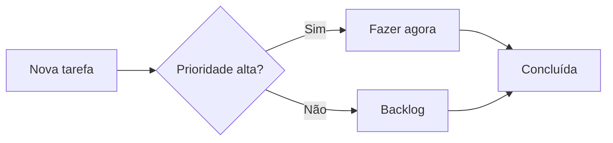
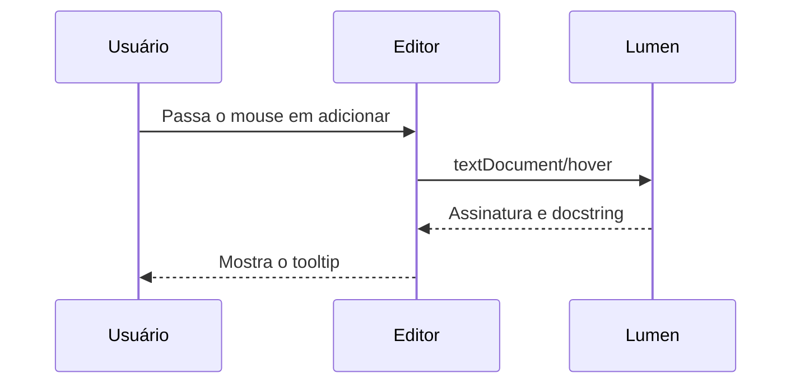
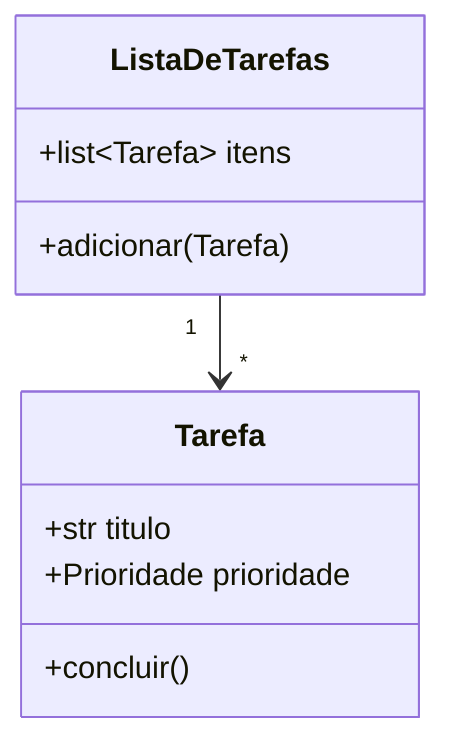
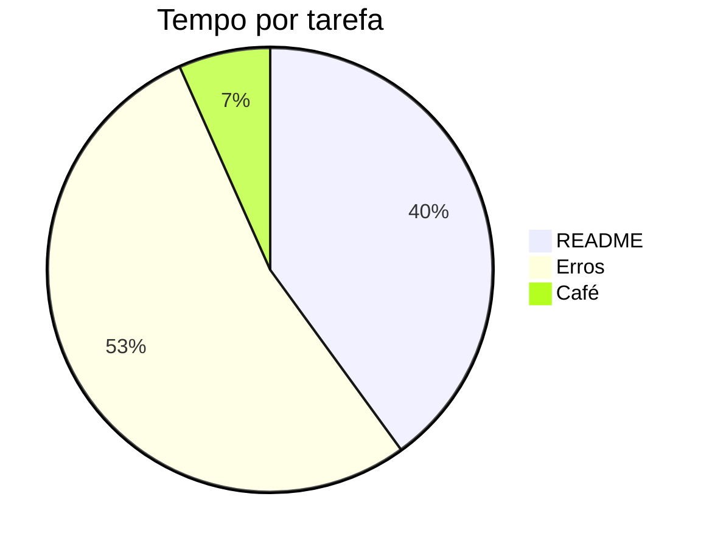

# Tarefas

Mini projeto para ver o Lumen com Python: diagnósticos (pyright + ruff), hover e completion.

- Código: [main.py](main.py), [modelos](tarefas/modelos.py)
- Este link está quebrado de propósito: [guia](docs/guia.md)

Experimente em `main.py`:

1. Passe o mouse sobre `adicionar` ou `Prioridade.ALTA` (hover).
2. Digite `lista.` numa linha nova (completion).
3. Corrija os três erros marcados no fim de `main()`.

## Exemplo de LaTeX

Inline: a fórmula de Bhaskara é $x = \frac{-b \pm \sqrt{b^2 - 4ac}}{2a}$.

Em bloco:

$$
\sum_{i=1}^{n} i = \frac{n(n+1)}{2}
\qquad
\int_{0}^{\infty} e^{-x^2}\,dx = \frac{\sqrt{\pi}}{2}
$$

Matriz:

$$
A = \begin{pmatrix} 1 & 2 \\ 3 & 4 \end{pmatrix},
\quad \det(A) = 1 \cdot 4 - 2 \cdot 3 = -2
$$

Equações alinhadas e casos:

$$
\begin{aligned}
(a + b)^2 &= (a + b)(a + b) \\
          &= a^2 + 2ab + b^2
\end{aligned}
\qquad
|x| = \begin{cases} x & \text{se } x \ge 0 \\ -x & \text{se } x < 0 \end{cases}
$$

Bloco com cerca `math`:

```math
\nabla \cdot \mathbf{E} = \frac{\rho}{\varepsilon_0}
```

---

# Vitrine de Markdown

Seções para testar o que um previewer deveria renderizar.

**Índice:** [Títulos](#títulos) · [Texto](#formatação-de-texto) · [Listas](#listas) · [Links e imagens](#links-e-imagens) · [Citações](#citações-e-alertas) · [Código](#código) · [Tabelas](#tabelas) · [Diagramas](#diagramas-mermaid) · [HTML](#html-embutido) · [Notas de rodapé](#notas-de-rodapé) · [Diversos](#diversos)

## Títulos

### Nível 3
#### Nível 4
##### Nível 5
###### Nível 6

Título com sublinhado (setext)
------------------------------

## Formatação de texto

Texto em **negrito**, *itálico*, ***negrito e itálico***, ~~riscado~~, `código inline` e **negrito com *itálico* dentro**.

Também com sublinhados: __negrito__ e _itálico_.

Sobrescrito e subscrito via HTML: E = mc<sup>2</sup>, H<sub>2</sub>O. Teclas: <kbd>Ctrl</kbd> + <kbd>Shift</kbd> + <kbd>P</kbd>. Destaque: <mark>texto marcado</mark>.

Quebra de linha forçada com barra invertida no fim\
e esta linha continua o mesmo parágrafo.

Caracteres escapados: \*não é itálico\*, \`não é código\`, \# não é título, 5 \* 3 = 15.

Emoji por shortcode: :rocket: :snake: :white_check_mark: e direto: 🚀 🐍 ✅

## Listas

Não ordenada, com aninhamento:

- Frutas
  - Maçã
  - Banana
    - Prata
    - Nanica
- Legumes
* Asterisco também funciona
+ E o sinal de mais

Ordenada, começando em 3:

3. Terceiro
4. Quarto
   1. Sub-item
   2. Outro sub-item
5. Quinto

Lista de tarefas:

- [x] Configurar pyright
- [x] Configurar ruff
- [ ] Corrigir os três erros em `main.py`
- [ ] Escrever testes

Item com parágrafo e código dentro:

1. Instale as dependências:

   ```bash
   pip install -e .
   ```

2. Rode o projeto:

   ```bash
   python main.py
   ```

## Links e imagens

- Link inline: [Python](https://www.python.org)
- Link com título: [Ruff](https://docs.astral.sh/ruff/ "Linter em Rust")
- Link por referência: [Pyright][pyright]
- Autolink: <https://github.com> e URL nua: https://pypi.org
- Âncora interna: [voltar para Tabelas](#tabelas)
- Arquivo do projeto: [modelos.py](tarefas/modelos.py)
- E-mail: <contato@exemplo.com>

[pyright]: https://github.com/microsoft/pyright

Imagem externa:


Imagem quebrada de propósito:


Imagem com link:

[](https://www.python.org)


## Citações e alertas

> Citação simples.
>
> Com um segundo parágrafo e **formatação**.
>
> > Citação aninhada.
> >
> > — Alguém importante

Alertas no estilo GitHub:

> [!NOTE]
> Informação útil que o leitor deveria saber.

> [!TIP]
> Uma dica para fazer melhor.

> [!IMPORTANT]
> Informação essencial.

> [!WARNING]
> Requer atenção imediata.

> [!CAUTION]
> Consequências negativas de uma ação.

## Código

Python:

```python
from dataclasses import dataclass
from enum import Enum


class Prioridade(Enum):
    BAIXA = 1
    ALTA = 3


@dataclass
class Tarefa:
    titulo: str
    prioridade: Prioridade = Prioridade.BAIXA

    def __str__(self) -> str:
        return f"[{self.prioridade.name}] {self.titulo}"
```

JSON:

```json
{
  "nome": "tarefas",
  "versao": "0.1.0",
  "ativo": true,
  "tags": ["demo", "lumen"]
}
```

TOML:

```toml
[tool.ruff]
line-length = 100
select = ["E", "F", "I"]
```

Diff:

```diff
- prioridade = "alta"
+ prioridade = Prioridade.ALTA
```

Shell com saída:

```console
$ python main.py
[ALTA] Escrever README
[BAIXA] Tomar café
```

Sem linguagem:

```
texto puro, sem destaque de sintaxe
```

Bloco indentado (4 espaços):

    def antigo():
        return "estilo indentado"

## Tabelas

Alinhamento à esquerda, centro e direita:

| Tarefa            | Prioridade | Horas |
| :---------------- | :--------: | ----: |
| Escrever README   |   `ALTA`   |   1.5 |
| Corrigir erros    |   `ALTA`   |     2 |
| Tomar café        |  `BAIXA`   |  0.25 |
| **Total**         |            | **3.75** |

Tabela com formatação, links e pipe escapado:

| Ferramenta | Função | Link |
| --- | --- | --- |
| pyright | Checagem de tipos | [repo](https://github.com/microsoft/pyright) |
| ruff | Lint *e* formatação | [docs](https://docs.astral.sh/ruff/) |
| `a \| b` | Pipe escapado | — |

## Diagramas (Mermaid)

Fluxograma:



Sequência:



Diagrama de classes:



Pizza:



## HTML embutido

<details>
<summary>Clique para expandir</summary>

Conteúdo escondido com **Markdown** dentro:

- item um
- item dois

```python
print("surpresa")
```

</details>

<p align="center">
  <b>Parágrafo centralizado via HTML</b><br>
  <i>com quebra de linha</i>
</p>

<table>
  <tr><th>HTML</th><th>Tabela</th></tr>
  <tr><td colspan="2" align="center">célula mesclada</td></tr>
</table>

<!-- Este comentário HTML não deve aparecer no preview -->

## Notas de rodapé

O Lumen usa pyright[^1] para tipos e ruff[^ruff] para lint.

[^1]: Verificador de tipos estático da Microsoft.
[^ruff]: Linter e formatador escrito em Rust, muito rápido.

## Diversos

Linhas horizontais em três sintaxes:

---

***

___

Lista de definição (nem todo previewer suporta):

Pyright
: Verificador de tipos.

Ruff
: Linter e formatador.

Parágrafo muito longo para testar quebra automática: Lorem ipsum dolor sit amet, consectetur adipiscing elit, sed do eiusmod tempor incididunt ut labore et dolore magna aliqua. Ut enim ad minim veniam, quis nostrud exercitation ullamco laboris nisi ut aliquip ex ea commodo consequat. Duis aute irure dolor in reprehenderit in voluptate velit esse cillum dolore eu fugiat nulla pariatur.

URL longa sem espaços: https://exemplo.com/um/caminho/muito/longo/que/nao/tem/espacos/e/precisa/quebrar/corretamente/no/preview?parametro=valor&outro=123
